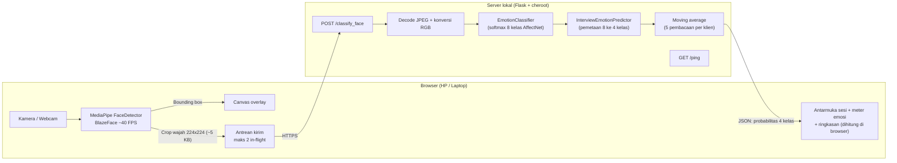

# Simulasi Wawancara Real-Time berbasis Deteksi Emosi Wajah (MobileNetV2 + AffectNet)

Aplikasi web yang membaca ekspresi wajah dari kamera (laptop atau HP) saat latihan wawancara dan menampilkan estimasi emosi secara real-time dalam empat kelas wawancara: **Happy, Neutral, Tense, Calm**. Setelah sesi selesai, pengguna mendapat ringkasan evaluasi.

> **Status: prototipe riset (Minggu 6: antarmuka dan ringkasan sesi sudah ada).** Belum ada angka akurasi yang valid untuk versi saat ini. Lihat [Status dan keterbatasan](#status-dan-keterbatasan-riset) sebelum mengutip hasil apa pun.

## Cara kerja



- **Deteksi wajah di browser.** MediaPipe Tasks Vision (BlazeFace) berjalan di peramban. Frame penuh tidak dikirim ke server; hanya crop wajah 224x224 (~5 KB).
- **Klasifikasi di server lokal.** Klasifikasi emosi (8 kelas AffectNet) memakai `classificator_full_model.pb` (bobot pre-trained, tanpa retraining).
- **Pemetaan emosi.** Delapan kelas AffectNet dipetakan ke empat kelas wawancara oleh `interview_model_wrapper.py`. Bobot pemetaan bersifat heuristik.
- **Ringkasan di browser.** Ringkasan sesi dihitung di peramban dan tidak disimpan di server.
- **Prinsip privasi.** Frame penuh kamera tidak meninggalkan perangkat. Crop wajah diproses di memori server lokal dan dibuang tanpa disimpan. Sistem **belum sepenuhnya client-side** karena klasifikasi masih di server. Catatan: model MediaPipe diunduh dari CDN (alamat IP perangkat terlihat oleh CDN, tetapi tanpa data wajah), dan jika memakai ngrok, lalu lintas melewati server ngrok.

---

## Persyaratan

- **Python 3.6** (environment pengembangan; TensorFlow 1.15 hanya mendukung Python 3.5-3.7). Cek dengan `python --version`.
- Paket langsung ada di [`requirements.txt`](requirements.txt). `requirements-lock.txt` adalah hasil `pip freeze` penuh untuk mereproduksi environment persis. File itu khusus **Windows** (memuat `pywin32`, `pywinpty`, `wincertstore`).
- Browser dengan akses internet (untuk mengunduh model MediaPipe dari CDN, kecuali memakai opsi self-host).

## Instalasi

```cmd
git clone https://github.com/<USERNAME>/<NAMA_REPO>.git
cd <NAMA_REPO>

conda create -n affectnet-env python=3.6
conda activate affectnet-env
pip install -r requirements.txt
```

## Menjalankan

### Langkah 1: Server lokal

```cmd
conda activate affectnet-env
python app.py
```

Tunggu log startup berikut:

```text
[startup] impor selesai: X s
[startup] model dimuat + pemanasan: Y s
[startup] siap dalam Z s -> https://<IP_LOKAL_LAPTOP>:5000
[startup] server: cheroot (keep-alive aktif)
```

Jika tampil `server: Flask dev (tanpa keep-alive)`, pasang cheroot: `pip install cheroot`.

Uji di laptop: buka `https://localhost:5000`. Peringatan sertifikat self-signed akan muncul; pilih **Lanjutkan / Proceed**.

### Langkah 2: Akses dari HP (satu jaringan Wi-Fi)

1. Hubungkan HP dan laptop ke Wi-Fi yang sama (5 GHz bila tersedia).
2. Buka di peramban HP, **dengan port 5000**:

   ```text
   https://<IP_LOKAL_LAPTOP>:5000
   ```

   IP laptop ada pada log startup, atau cek dengan `ipconfig`.
3. Peringatan sertifikat muncul sekali per perangkat. Pilih **Lanjutkan / Proceed** (di Chrome: *Advanced* lalu *Proceed*).
4. Izinkan akses kamera. Kamera dari peramban HP hanya bisa diminta lewat `https://` atau `localhost`.

Panel debug (bagian "Info teknis untuk pengujian" di kaki halaman):

| Metrik | Arti |
| --- | --- |
| `Deteksi lokal` | FPS deteksi wajah di browser |
| `ping` | RTT request kosong ke server (jaringan dan koneksi) |
| `RTT klasifikasi` | Waktu total dari pengiriman crop sampai estimasi emosi diterima |
| `server X ms (inferensi Y, antre Z)` | Waktu di server; inferensi adalah klasifikasi murni, antre adalah menunggu giliran |
| `kirim` | Ukuran crop JPEG yang dikirim (~5 KB) |

---

## Fitur pengujian dan konfigurasi

### Mode demo (tanpa kamera dan tanpa model)

Tambahkan `?demo=1` pada alamat, misalnya `https://localhost:5000/?demo=1`. Seluruh alur (persiapan, simulasi, ringkasan) berjalan dengan kamera dan emosi simulasi. Spanduk "Mode demo" selalu tampil. **Jangan mengutip angka dari mode demo.**

### Variabel lingkungan (opsional)

Setel di terminal sebelum `python app.py`:

| Perintah | Efek |
| --- | --- |
| `set USE_HTTPS=0` | Server HTTP biasa (misalnya di belakang ngrok) |
| `set USE_CHEROOT=0` | Server dev Flask (tanpa keep-alive) |

### Alternatif: ngrok (jika HP tidak satu Wi-Fi)

1. `set USE_HTTPS=0`, lalu `python app.py`.
2. Terminal baru; sekali saja: `ngrok config add-authtoken TOKEN_ANDA`
3. `ngrok http 5000 --region ap` (jika flag `--region` ditolak oleh versi ngrok Anda, jalankan tanpa flag itu).
4. Buka URL `https://xxxx.ngrok-free.dev` di HP.

### Opsional: self-host MediaPipe (tanpa CDN pihak ketiga)

1. `npm pack @mediapipe/tasks-vision@0.10.14`, ekstrak, lalu salin `vision_bundle.mjs` dan folder `wasm/` ke `static/mediapipe/`.
2. Unduh `blaze_face_short_range.tflite` ke `static/mediapipe/`.
3. Di `static/app.js`, ubah `selfHost: false` menjadi `selfHost: true`.

### Pemecahan masalah

- **HP tidak bisa membuka halaman** ("took too long" atau "refused"): izinkan Python di Windows Firewall untuk jaringan *Private* (atau tambahkan aturan inbound TCP 5000), pastikan profil Wi-Fi laptop *Private*, dan pastikan router tidak memakai *client isolation* (umum pada Wi-Fi tamu atau kampus). Uji dulu dengan membuka `https://<IP_LOKAL_LAPTOP>:5000` di laptop sendiri.
- **IP laptop berubah:** hapus folder `certs\` agar sertifikat dibuat ulang, lalu jalankan ulang server.
- **"Kamera memerlukan HTTPS":** halaman dibuka lewat `http://` selain `localhost`. Gunakan `https://`.
- **"Gagal memuat model deteksi wajah":** perangkat tidak bisa menjangkau CDN MediaPipe. Periksa internet atau pakai self-host.
- **`ERR_NGROK_334`:** `taskkill /f /im ngrok.exe`, lalu jalankan ulang ngrok.
- **Tampilan tidak berubah setelah mengedit `static/`:** hard reload (Ctrl+F5, atau Cmd+Shift+R di Mac).
- **`antre` besar di panel debug:** turunkan `maxInFlight` menjadi `1` atau naikkan `minIntervalMs` di `CONFIG` pada `static/app.js`.

---

## Struktur proyek

```text
<NAMA_REPO>/
  app.py                       Server Flask + cheroot (menyajikan static/, /classify_face, /ping)
  emotion_classifier.py        Memuat model, mengembalikan softmax 8 kelas
  interview_model_wrapper.py   Pemetaan 8 ke 4 kelas dan normalisasi
  requirements.txt             Dependensi langsung
  requirements-lock.txt        pip freeze penuh (Windows)
  README.md
  certs/                       Dibuat otomatis (jangan di-commit)
  deployment/frozen_graphs/
    classificator_full_model.pb
  static/
    index.html                 Tiga layar: persiapan, simulasi, ringkasan
    style.css                  Tema terang/gelap, ukuran teks, pola emosi, gaya cetak
    app.js                     Deteksi MediaPipe, sesi, ringkasan, mode demo
```

Berkas versi lama (detektor SSD di server, regressor, versi awal `app.py`) sudah dihapus dari repo karena tidak dipakai. Riwayatnya ada di git.

## Fitur antarmuka

- **Persiapan:** jumlah pertanyaan, waktu per pertanyaan (bisa "tanpa batas"), pratinjau kamera tampil atau sembunyi, persetujuan.
- **Simulasi:** satu pertanyaan per layar, timer, jeda, meter ekspresi langsung. Banyak pertanyaan bergaya wawancara HRD tersedia di `static/app.js`.
- **Ringkasan:** gambaran umum, rincian per pertanyaan, garis waktu sepanjang sesi, catatan latihan, keterangan keandalan, tabel data. Bisa dicetak atau disimpan sebagai PDF, diunduh sebagai JSON, atau dihapus.

## Aksesibilitas dan fitur inklusif

Dirancang mengikuti prinsip WCAG 2.1.

- **Pengodean ganda:** setiap kelas emosi punya warna, label teks, **dan** pola visual, sehingga tidak bergantung pada warna saja.

  | Kelas | Warna | Pola |
  | --- | --- | --- |
  | Happy | `#FDAE61` (oranye) | bintik |
  | Neutral | `#2B83BA` (biru) | garis tegak |
  | Tense | `#D7191C` (merah) | garis miring |
  | Calm | `#ABDDA4` (hijau) | garis datar |

- **Tampilan:** tema terang, gelap, atau ikuti perangkat; ukuran teks Normal, Besar, Sangat besar; kurangi gerakan.
- **Kontrol:** dapat dioperasikan dengan keyboard, fokus terlihat, target sentuh minimal 44 px. Timer bisa dimatikan, sesi bisa dijeda, dan pratinjau kamera bisa disembunyikan.
- **Cetak/PDF:** aturan `@media print` mempertahankan warna dan pola.

---

## Temuan teknis penting

- Pipeline versi lama meneruskan **label argmax**, bukan probabilitas, ke pemetaan 8 ke 4 kelas, sehingga pemetaan bekerja pada vektor one-hot (misalnya Surprised selalu menjadi Neutral). Versi sekarang memakai softmax asli.
- Server dev Werkzeug selalu mengirim `Connection: close`, sehingga handshake TLS diulang di tiap request. Karena itu dipakai cheroot (keep-alive).

## Status dan keterbatasan riset

- **Belum ada akurasi valid** untuk pipeline saat ini. Pemetaan 8 ke 4 kelas masih heuristik dan belum dikalibrasi.
- Model mengklasifikasi tampilan wajah, **bukan** Action Unit FACS. Pemetaan Tense dan Calm adalah heuristik terinformasi FACS, bukan deteksi otot.
- Sistem menilai ekspresi yang tampak, bukan emosi internal atau kelayakan kandidat. Cara orang berekspresi berbeda karena budaya, kebiasaan, dan kondisi yang memengaruhi gerak wajah.
- Hanya satu wajah utama per sesi.

## Catatan untuk pengembang dan lisensi

- File `.pb` bisa melebihi batas 100 MB per file di GitHub. Gunakan [Git LFS](https://git-lfs.com) atau jangan di-commit dan dokumentasikan sumber unduhannya.
- Bobot dan arsitektur klasifikasi berasal dari repositori `djordjebatic/AffectNet` berdasarkan karya tulis ilmiah AffectNet oleh Mollahosseini et al.
- Jangan commit `certs/` (berisi private key), data uji berisi wajah orang, atau token (misalnya authtoken ngrok).
