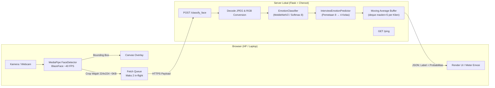

# Simulasi Wawancara Real-Time berbasis Deteksi Emosi Wajah (MobileNetV2 + AffectNet)

Aplikasi web yang membaca ekspresi wajah dari kamera (laptop atau HP) saat latihan wawancara dan menampilkan estimasi emosi secara real-time dalam empat kelas wawancara: **Happy, Neutral, Tense, Calm**.

> **Status: prototipe riset (Minggu 6: antarmuka dan ringkasan sesi sudah ada).** Belum ada angka akurasi yang valid untuk versi saat ini. Lihat bagian [Status dan keterbatasan](#status-dan-keterbatasan) sebelum mengutip hasil apa pun.

## Cara Kerja



* **Client-Side Face Detection:** Deteksi wajah berjalan **di browser** menggunakan MediaPipe Tasks Vision. Frame penuh tidak dikirim ke server; hanya crop wajah $224\times224$ (~5 KB).


* **Server-Side Classification:** Klasifikasi emosi (8 kelas AffectNet) berjalan **di server lokal** dengan `classificator_full_model.pb` (bobot pre-trained, tanpa retraining).


* **Emotion Mapping:** Delapan kelas AffectNet dipetakan ke empat kelas wawancara oleh `interview_model_wrapper.py`.


* **Jaminan Privasi:** Frame penuh kamera tidak pernah meninggalkan perangkat; crop wajah biner diproses di memori server lokal dan langsung dibuang tanpa disimpan.


---

## Cara Menjalankan Project (Minggu 6)

### Ringkasan Perubahan Utama

* **File Eksekusi:** Server utama disatukan di `app.py`.


* **Struktur Antarmuka:** Seluruh berkas frontend berada di folder `static/` (`index.html`, `style.css`, `app.js`).


* **Persyaratan HTTPS:** Akses kamera dari peramban HP **hanya bisa diminta** melalui protokol `https://` atau `localhost`.


* **Server Production:** Mode default menggunakan server **Cheroot** (mendukung HTTPS self-signed dan koneksi *HTTP keep-alive*).


### Struktur Folder Proyek

```text
E:\DS-Interview-Project\AffectNet\
  ├── app.py                      # Server utama Flask + Cheroot
  ├── emotion_classifier.py       # Predictor 8-kelas AffectNet
  ├── interview_model_wrapper.py  # Wrapper pemetaan 8 ke 4 kelas
  ├── README.md                   # Dokumentasi proyek
  ├── certs\                      # Dibuat otomatis saat server pertama kali berjalan
  ├── deployment\
  │   └── frozen_graphs\
  │       └── classificator_full_model.pb
  └── static\                     # Berkas antarmuka web
      ├── index.html
      ├── style.css
      └── app.js
```


### Langkah 0: Instalasi Lingkungan (Sekali Saja)

1. Buka **Anaconda Prompt**.
2. Aktifkan environment dan pasang dependensi server tambhan:


```cmd
conda activate affectnet-env
pip install cheroot cryptography

```

---

### Langkah 1: Jalankan Server Lokal

1. Masuk ke direktori proyek:


```cmd
cd path/ke/folder/AffectNet
```

2. Pastikan environment Anaconda aktif, lalu jalankan server:


```cmd
conda activate affectnet-env
python app.py

```

3. Tunggu hingga terminal menampilkan log startup:


```text
[startup] impor selesai: X s
[startup] model dimuat + pemanasan: Y s
[startup] siap dalam Z s -> https://<IP_LOKAL_LAPTOP>
[startup] server: cheroot (keep-alive aktif)

```

Jika tampil `server: Flask dev (tanpa keep-alive)`, pastikan `cheroot` terpasang di environment Anda (`pip install cheroot`).

4. **Uji di Laptop:** Buka `https://localhost:5000` di peramban. Jika muncul peringatan sertifikat SSL self-signed, pilih **Lanjutkan / Proceed**.


---

### Langkah 2: Akses dari Smartphone (Satu Jaringan Wi-Fi)

1. Pastikan HP dan laptop terhubung ke jaringan Wi-Fi yang sama (gunakan frekuensi 5 GHz jika tersedia).


2. Buka peramban HP, ketik alamat URL yang tampil di log startup terminal (atau cek IP dengan perintah `ipconfig`):


```text
https://<IP_LOKAL_LAPTOP>

```


3. Peringatan sertifikat SSL akan muncul sekali per perangkat. Pilih **Lanjutkan / Proceed** (Pada Chrome: klik *Advanced* / *Lanjutan* $\rightarrow$ *Proceed*).


4. Berikan izin akses kamera. Panel debug di bawah pratinjau video akan menampilkan metrik real-time.


Cara Membaca Panel Debug:

* `Deteksi lokal`: Frame rate (FPS) deteksi wajah lokal di browser.


* `ping`: Waktu RTT request kosong ke server (mengukur latensi jaringan & koneksi).


* `klasifikasi RTT`: Waktu total dari pengiriman crop wajah hingga menerima estimasi emosi.


* `server X ms (infer Y, antre Z)`: Waktu pemrosesan server (`infer`: klasifikasi murni, `antre`: waktu menunggu antrean lock).


* `kirim`: Ukuran payload crop JPEG yang dikirim (~5 KB).


---

### Fitur Pengujian & Konfigurasi Tambahan

#### Mode Demo (Tanpa Kamera & Tanpa Model)

Tambahkan parameter `?demo=1` pada URL browser (misal: `https://localhost:5000/?demo=1`). Seluruh alur (persiapan, simulasi, ringkasan) akan berjalan menggunakan data kamera dan emosi simulasi tanpa memerlukan model AI. Spanduk indikator "Mode demo" akan muncul secara otomatis.

#### Pengaturan Variabel Lingkungan (Opsional)

Setel pada terminal sebelum mengeksekusi `python app.py`:

| Perintah Terminal | Fungsi & Efek |
| --- | --- |
| `set USE_HTTPS=0` | Jalankan server pada mode HTTP standar (misalnya jika menggunakan tunneling ngrok)

 |
| `set USE_CHEROOT=0` | Menggunakan server bawaan Flask development (tanpa keep-alive)

 |

#### Alternative Tunneling: ngrok (Jika HP Tidak Satu Wi-Fi)

1. Matikan HTTPS server: `set USE_HTTPS=0` lalu jalankan `python app.py`.


2. Buka terminal baru, tambahkan authtoken (jika penggunaan pertama):


```cmd
ngrok config add-authtoken TOKEN_AUTHTOKEN_ANDA

```


3. Jalankan tunneling (Gunakan region Asia agar RTT rendah):


```cmd
ngrok http 5000 --region ap

```


4. Akses URL `https://xxxx.ngrok-free.dev` yang diberikan melalui browser HP Anda.


#### Opsional: Self-Host MediaPipe (Penggunaan Offline)

1. Unduh paket npm `@mediapipe/tasks-vision` versi `0.10.14` (`npm pack @mediapipe/tasks-vision@0.10.14`), ekstrak, lalu salin berkas berikut ke folder `static/mediapipe/`:


* `vision_bundle.mjs`


* Isi direktori `wasm/`


2. Unduh model `blaze_face_short_range.tflite` dan simpan di `static/mediapipe/`.


3. Pada file `static/app.js`, ubah konfigurasi `selfHost: false` menjadi `selfHost: true`.


---

### Pemecahan Masalah (Troubleshooting)

* **HP Tidak Bisa Membuka Halaman:** Pastikan Python diizinkan melewati Windows Firewall untuk jaringan *Private*, dan pastikan router Wi-Fi tidak mengaktifkan fitur *client isolation* (biasa ada pada Wi-Fi publik/guest).


* **IP Laptop Berubah:** Hapus folder `certs\` agar sertifikat SSL dibuat ulang secara otomatis sesuai alamat IP baru, lalu restart server.


* **Pesan "Kamera memerlukan HTTPS":** Halaman diakses melalui HTTP biasa selain `localhost`. Gunakan prefix `https://`.


* **Gagal Memuat Model Deteksi Wajah:** Perangkat HP/laptop tidak dapat menjangkau CDN MediaPipe. Cek koneksi internet atau gunakan opsi *self-host*.


* **Error `ERR_NGROK_334` (Session Already Online):** Hentikan proses ngrok lama yang menggantung di latar belakang:


```cmd
taskkill /f /im ngrok.exe

```


* **Tampilan Tidak Berubah Setelah Edit `static/`:** Lakukan *hard reload* peramban (Ctrl + F5 di Windows/Linux atau Cmd + Shift + R di Mac).


* **Antrean Server Tinggi (`antre` besar):** Kurangi nilai `maxInFlight` di bagian `CONFIG` pada `static/app.js` menjadi `1`, atau tingkatkan `minIntervalMs`.


---

## Status File Project

| File | Status | Keterangan |
| --- | --- | --- |
| `app.py` | **Aktif (jalankan ini)** | Server utama: menyajikan `static/`, endpoint `/classify_face` dan `/ping`. HTTPS self-signed, server cheroot.

 |
| `static/index.html` | **Aktif** | Struktur tiga layar: persiapan, simulasi, ringkasan.

 |
| `static/style.css` | **Aktif** | Gaya visual Krem (Warm Sand), tema terang/gelap, ukuran teks, pola emosi blind-friendly, dan gaya cetak/PDF.

 |
| `static/app.js` | **Aktif** | Deteksi wajah MediaPipe, pengiriman crop, sesi wawancara (15 pertanyaan HRD), kalkulasi ringkasan, mode demo.

 |
| `emotion_classifier.py` | **Aktif** | Memuat `classificator_full_model.pb`, mengembalikan probabilitas softmax 8 kelas.

 |
| `interview_model_wrapper.py` | **Aktif** | `InterviewEmotionPredictor`: pemetaan 8 ke 4 kelas dan normalisasi.

 |
| `deployment/frozen_graphs/classificator_full_model.pb` | **Aktif** | Model klasifikasi emosi.

 |
| `deployment/tensorflow_detector.py` | Legacy | Detektor SSD + klasifikasi + regressor; hanya dipakai skrip legacy.

 |
| `deployment/frozen_graphs/frozen_inference_graph_face.pb` | Legacy | Detektor wajah SSD; tidak dipakai versi MediaPipe.

 |
| `deployment/frozen_graphs/regressor_full_model.pb` | Legacy | Regressor valence/arousal; tidak dipakai.

 |

---

## Aksesibilitas dan Fitur Inklusif (WCAG 2.1)

* **Desain Warna Aksesibel (Blind-Friendly):** Memakai palet warna emosi *ColorBrewer* yang selaras dengan tema Krem (*Warm Sand*):


* **Happy:** `#FDAE61` (Kuning/Oranye) + Pola bintik
* **Neutral:** `#2B83BA` (Biru) + Pola garis tegak
* **Tense:** `#D7191C` (Merah) + Pola garis miring
* **Calm:** `#ABDDA4` (Hijau) + Pola garis datar


* **Prinsip Double Encoding:** Setiap kelas emosi memiliki warna, label teks eksplisit, dan tekstur pola visual sehingga penderita buta warna (Protanopia, Deuteranopia, Tritanopia) dapat mengenali emosi secara instan.


* **Konsistensi PDF/Cetak:** Aturan `@media print` diselaraskan agar hasil cetak/PDF mempertahankan palet warna dan tekstur pola emosi.


* **Kustomisasi Tampilan:** Mendukung tema terang/gelap, ukuran teks (Normal, Besar, Sangat Besar), serta pengurangan gerakan (*reduced motion*).


* **Navigasi Keyboard & Screen Reader:** Seluruh elemen interaktif dapat diakses melalui tombol keyboard, memiliki *focus indicator* yang kontras, serta memenuhi target sentuh minimal 44 px.


---

## Status dan Keterbatasan Riset

* **Akurasi & Validasi Model:** Pemetaan 8 kelas AffectNet ke 4 kelas wawancara masih bersifat heuristik dan perlu dikalibrasi lebih lanjut.


* **Ekspresi vs Status Mental:** Sistem menilai ekspresi wajah yang tampak, bukan mengukur emosi internal yang sebenarnya atau kualifikasi profesional kandidat.


* **Penggunaan Tunggal:** Sistem saat ini hanya dirancang untuk mendeteksi 1 wajah utama dalam satu sesi wawancara.


---

## Catatan untuk Pengembang & Lisensi

* File bobot model `.pb` dapat melebihi batas 100 MB di GitHub. Pastikan menggunakan **Git LFS** atau menambahkan daftar file besar ke `.gitignore` sebelum melakukan push.


* Jangan melakukan commit pada folder `certs/` karena berisi *private key* SSL lokal.
